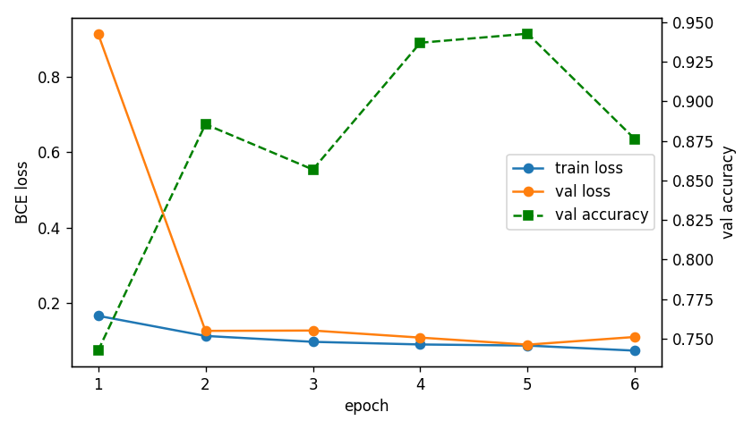
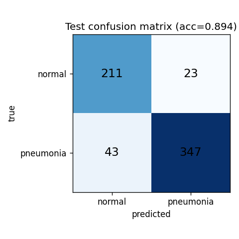
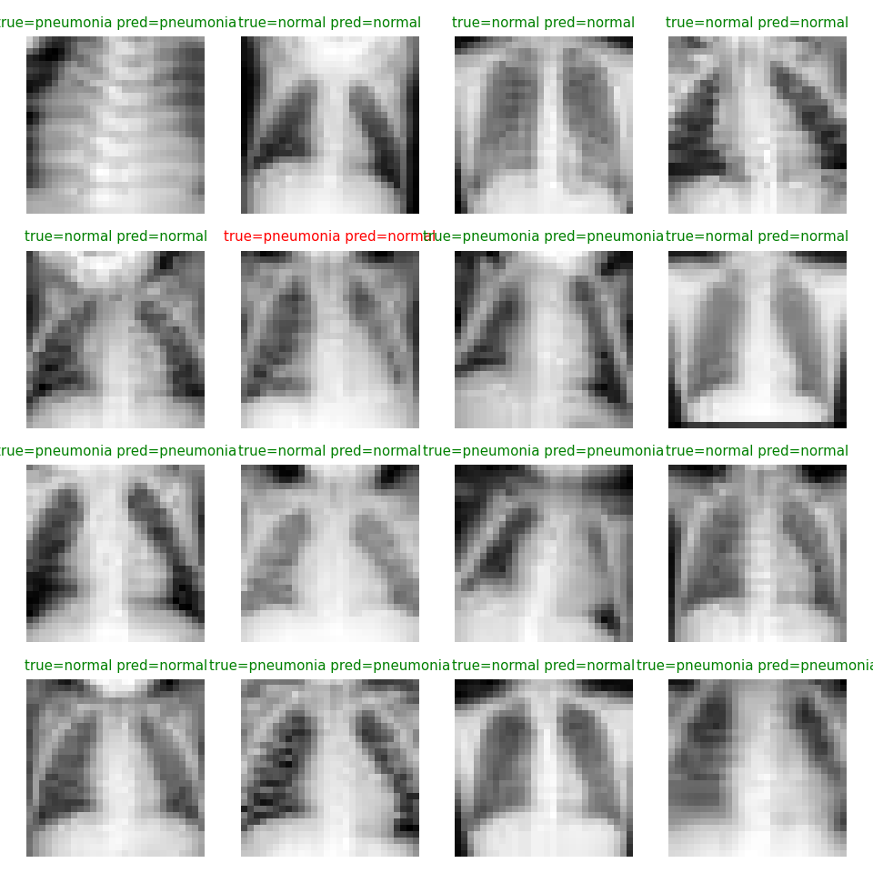

# Pneumonia Detection in Chest X-Rays (PyTorch CNN)

A complete, reproducible deep-learning pipeline that classifies chest X-rays as
**normal** or **pneumonia**. Built on PneumoniaMNIST, a standardized medical
imaging benchmark, with a custom compact CNN, explicit handling of class
imbalance, and a full evaluation suite.

## Results (held-out test set, 624 images)

| Metric | Value |
|---|---|
| Accuracy | **0.894** |
| ROC-AUC | **0.955** |
| Precision (pneumonia) | 0.938 |
| Recall (pneumonia) | 0.890 |

Confusion matrix (rows = true label, columns = predicted):

| | normal | pneumonia |
|---|---|---|
| **normal** | 211 | 23 |
| **pneumonia** | 43 | 347 |

| Training curves | Confusion matrix | Sample predictions |
|---|---|---|
|  |  |  |

Exact numbers (including the training config) are in
[results/metrics.json](results/metrics.json). Everything above is produced by
`python train.py` on a CPU in about two minutes.

## Dataset

[PneumoniaMNIST](https://medmnist.com/) (MedMNIST v2, hosted on Zenodo):
28x28 grayscale chest X-rays derived from the pediatric cohort of Kermany et
al. (*Cell*, 2018). 4,708 train / 524 validation / 624 test images, with a
roughly 3:1 pneumonia-to-normal imbalance in the training split. `train.py`
downloads the npz automatically on first run (cached under `data/`).

Why this dataset: it is small enough to train on a laptop CPU in minutes,
while still being a real medical-imaging task with the properties that make
medical ML hard: low resolution, class imbalance, and asymmetric error costs
(missing pneumonia is worse than a false alarm).

## Approach

- **Model** (`model.py`): custom CNN, ~93k parameters. Three convolutional
  blocks with batch normalization, then global average pooling and a single
  linear layer. GAP instead of a flattened fully-connected head keeps the
  parameter count low on a small dataset and makes the network largely
  input-size agnostic.
- **Class imbalance**: `BCEWithLogitsLoss` with `pos_weight = neg/pos`
  (~0.35), so the majority pneumonia class is down-weighted instead of the
  model learning to always predict pneumonia.
- **Training**: Adam, lr 1e-3, batch size 128, 6 epochs, fixed seed (42) for
  reproducibility. Validation loss/accuracy tracked every epoch.
- **Evaluation**: accuracy, ROC-AUC, precision, recall and confusion matrix
  on the untouched test split; ROC-AUC is reported alongside accuracy because
  it is threshold-independent, which matters on imbalanced medical data.

## Repository structure

```
model.py            CNN architecture
train.py            data download, training loop, evaluation, figure export
notebooks/          notebook walkthrough of the same pipeline
results/            metrics.json + generated figures (git-tracked)
requirements.txt    pinned-enough dependencies
STUDY_NOTES.md      interview-style questions and answers about this code
```

## How to run

```bash
pip install -r requirements.txt
python train.py --epochs 6 --outdir results
```

Artifacts (metrics, figures, model weights) are written to `results/`.
The notebook in `notebooks/` walks through the same pipeline step by step
with visualizations.

## Possible improvements

- Fine-tune a pretrained ResNet on the full-resolution source images instead
  of 28x28 thumbnails.
- Tune the decision threshold on the validation set for a target recall
  (e.g. 0.95) rather than using 0.5, and calibrate probabilities.
- Data augmentation (small rotations, shifts) to reduce val-set variance.

## License

MIT. See [LICENSE](LICENSE).
